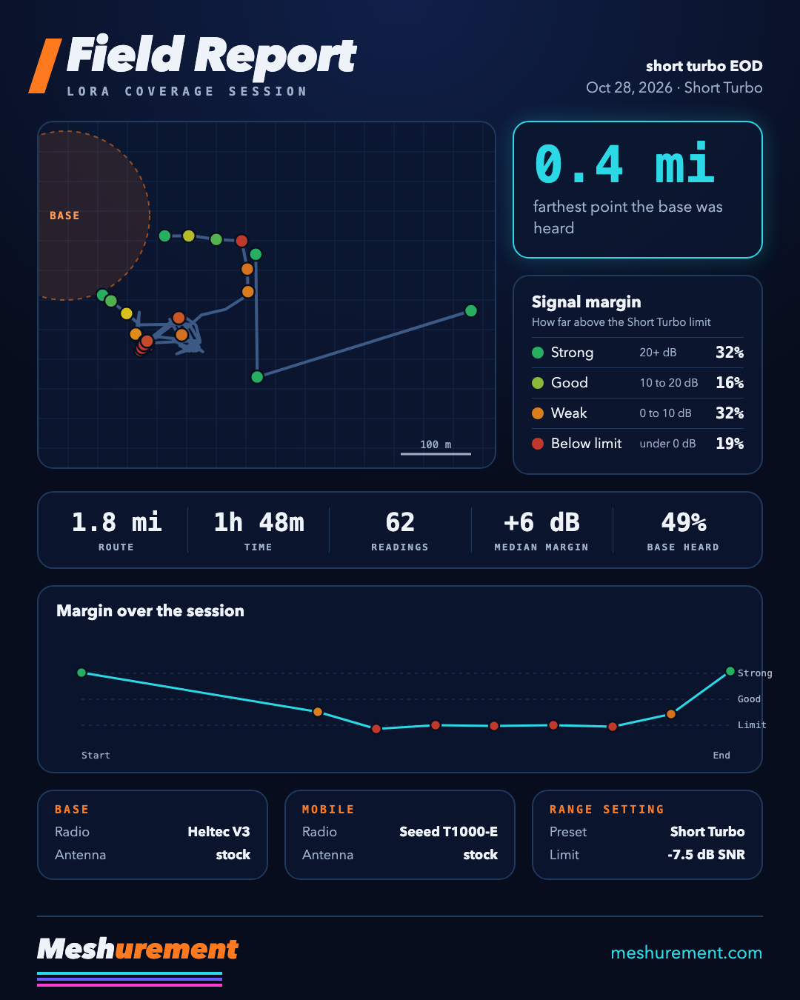

# Field Report: a shareable session card (design, 2026-11-05)

Goal: one image per session (and per comparison) that people want to post. Every post carries the name and meshurement.com, so it is the app's cheapest growth channel. It has to be honest, readable at a glance on a phone feed, and must never give away where someone lives.

Starting point: Andy's concept (2026-11-05, "Field Report / RF coverage session"). The mock below keeps its layout and is built from a real session, not invented numbers.

Session 32, "short turbo EOD", 2026-10-28, Short Turbo, Heltec V3 base and T1000-E mobile, 108 minutes, 62 readings. Numbers from a copy of the phone's database by `tool/field_report/stats.py` (same rules the app would use), drawn by `tool/field_report/render.py` and headless Chrome. Both scripts are prototypes for this doc, not app code.

## What the card shows

| Block | Content | Source in the app |
|---|---|---|
| Header | "Field Report", session name, date, range setting | `sessions.name`, `started_at`, `lora_preset` display name |
| Brag tile | **Farthest point the base was heard**, big | max distance from the base location over received samples (beacon, ping reply) |
| Route map | track line, sample dots coloured by margin, base as a hazed zone, 100 m scale bar | packet event fixes; `SignalColorMapper.fromMargin` |
| Signal margin | Strong 20+ dB, Good 10 to 20, Weak 0 to 10, Below limit under 0, as % of readings | SNR minus `RadioPreset.snrFloorDb` per sample; same thresholds as the Live map legend |
| Stat row | route length, time, readings, median margin, base heard % | `trackDistanceM`; session duration; sample count; median margin; (beacons heard + pings answered) / (beacons expected + pings on air) |
| Margin over the session | median margin in 12 time bins, dots on the same ramp | samples by timestamp |
| Setup | base and mobile radio and antenna, range setting and its SNR limit | session rig JSON (hardware profiles), preset |
| Footer | meshurement.com, small (no logo, 2026-11-06) | constant |

Later sessions (schema v9) also have region, frequency, TX power and hop limit; the setup row shows TX power and frequency when present.

## Changes from the concept

1. **Privacy first, by default.** No street tiles. The route is drawn on a plain grid, rotated by a fixed angle per session so the shape can't be laid over a street map, and nothing is drawn within 120 m of the base, which shows as a hazed zone labelled BASE. The base is usually someone's home, and a route that starts on a street map is a home address. A "Show streets" toggle can come later; when it is on, the image needs the OSM attribution line and a warning.
2. **One consistent set of numbers.** The concept's median SNR (-1.5 dB) contradicted its SNR range (11.8 to 14.5) and its 48% Strong. The card uses one sample set and reports margin (SNR above the range setting's limit), because that is what the colours mean and it compares across range settings. Raw SNR and RSSI ranges move to an optional details strip.
3. **The brag is distance from the base, not route length.** "0.4 mi" is how far away the base was still heard; route length (1.8 mi) is a supporting stat. Distance from the base is what people compare and argue about.
4. **"Base heard" instead of "packet delivery".** One number for the whole link: beacons heard plus pings answered, over beacons expected plus pings sent on air. NAKs and throttled pings are excluded (nothing was transmitted). Session 32 scores 49% because the base beacon was missing for long stretches, which is the honest answer.
5. **Dropped fields the app doesn't know or users don't need:** max retransmit, RX mode, "Channel 0", airtime percentage.

## What the real data taught us

- **Sessions filed on the wrong map break distances.** Sessions 23, 29 and 32 were recorded about 200 m from the "home v3" base but are filed on the "Work" map, whose base location is 49.7 km away; session 34 ("Marcus") is the reverse. Measured from their own map, the card would claim 30 mi. The card must measure from the base radio's location for that session, and the app should warn when a session's track is far from its map's base (a likely "Move session to another map" nudge). The mock uses `--base-map 11` for this reason.
- **A single fix can be the farthest point.** Session 32's 0.4 mi is one reading taken while driving away at the end (5 m accuracy, 10 m/s). It is real, but the brag tile should require at least two readings within 50 m of each other before it counts a distance, so one GPS spike can't become the headline.
- **Most sessions are short walks near home.** With a 120 m privacy radius, a neighborhood walk keeps most of its route; a 250 m radius left session 30 with 7 of 782 dots. Keep the radius small and rely on rotation and no tiles.
- **The base beacon gap shows clearly in the chart.** Session 32's margin sits at the limit for most of the hour, then recovers: a story the chart tells without words.

## Formats

| Format | Size | Use |
|---|---|---|
| Feed (default) | 1080 x 1350 | Instagram, Facebook, Mastodon, Discord |
| Story | 1080 x 1920 | Instagram and Facebook stories: map taller, setup row dropped |
| Wide | 1200 x 675 | X, Reddit and link previews: map left, brag and margins right, no chart |

## Comparison card (guided tests and rig comparison)

The most shareable result the app produces. Same frame, two or more columns: each setup's name (antenna, range setting, radio or TX power), its farthest heard distance and median margin, the winner highlighted with the margin of the win ("Whip antenna reached 0.6 mi farther, +4 dB median margin"), and the never-null verdict line from `PlanAnalysisResult`. Routes side by side on one shared grid.

## How it would be built

- A Flutter widget (`FieldReportCard`) laid out at the target pixel size, rendered off-screen with `RepaintBoundary.toImage`, encoded to PNG and handed to the share sheet. No server, nothing leaves the phone until the user shares it.
- Route painter: `CustomPainter` over the projected, rotated, trimmed track. No `flutter_map`, so no tiles and no attribution needed.
- Entry points: map detail (per session), the session panel after End session ("Share field report"), the guided test result and rig comparison (comparison card).
- Data: a `FieldReportData` value built from the session's events, the same sample rules as maps and exports (`SourceKind.notSamples` excluded, `PingResult` outcomes for delivery), and the base location for that session. Pure Dart, unit-tested against fixtures copied from real sessions like session 32.
- Name: the card says "Meshurement" and meshurement.com from day one, through the app-name constant Phase 3 of the rename introduces.

## Pro or free (decided 2026-11-05)

| | Free | Pro |
|---|---|---|
| Single-session card, all three formats (feed, story, wide) | ✓ | ✓ |
| Comparison card, two setups | ✓ | ✓ |
| Comparison card, three or four setups | | ✓ |
| meshurement.com footer | always | always |

Follows the existing guided-test line (two setups free, three and four Pro). The footer is never removable: every share is an ad.

## Decisions (Andy, 2026-11-05)

1. ~~Miles or kilometres?~~ **Decided 2026-11-05:** follow the phone's region (`milesForCountry`) for every distance on the card, scale bar included (feet or metres), with a Settings override (Units: Automatic, Miles, Kilometres) that the card and the rest of the app both honour.
2. ~~Should the session name appear?~~ **Decided 2026-11-05:** sharing opens a **report generation sheet** before anything is rendered. Its first field is an editable card title, prefilled with something safe (range setting and date, e.g. "Short Turbo · Oct 28, 2026"), never the session name; editing it does not rename the session. The sheet is also where the other per-share choices live (format, and whatever questions 3 and 4 decide), with a live preview of the card and a Share button.
3. ~~Hidden radius?~~ **Decided 2026-11-05:** a "Hide base area" choice in the report generation sheet: Off, 120 m (default), 300 m (shown in feet in miles regions), with the preview updating live. Rotation and no street tiles stay on regardless. "Show streets" (tiles, OSM credit, warning) is deferred until someone asks for it. **Built 2026-11-05 (Andy asked):** a Background choice, Plain / Streets / Terrain, remembered between reports and with no warning (Andy's choice); a map turns rotation off and prints the tile credit; Hide base area stays. Satellite imagery was skipped (no licence that allows shared images without a key and a bill; USGS imagery is the free US-only option if it comes back).
4. ~~Free or Pro?~~ **Decided 2026-11-05:** see "Pro or free" above.
